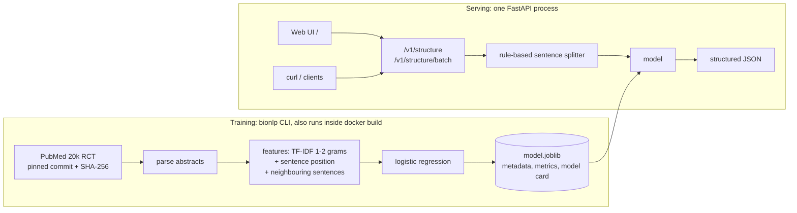

# BioNLP Abstract Structurer

[](https://github.com/zeineeb33/BioNLP-sentence-classifier/actions/workflows/ci.yml)

**Live demo:** https://bionlp-abstract-structurer.onrender.com (free Render instance: the first request after a period of inactivity can take up to a minute while it wakes up) · [API docs](https://bionlp-abstract-structurer.onrender.com/docs)

Paste a raw biomedical abstract and get it back structured: every sentence is labelled
**BACKGROUND / OBJECTIVE / METHODS / RESULTS / CONCLUSIONS** and returned as JSON, with a
color-coded web view. The model is trained on [PubMed 20k RCT](https://github.com/Franck-Dernoncourt/pubmed-rct)
by a reproducible pipeline, served by FastAPI, packaged in a 430 MB Docker image that idles at
~170 MiB of RAM, and deployable on Render's free tier from this repo alone.



## Features
- **Abstract structuring API**: raw text or pre-split sentences, a batch endpoint, `/health`,
  `/v1/model` (metadata + metrics), OpenAPI docs at `/docs`.
- **Context-aware model**: sentence position and neighbouring-sentence features add 6.8 points
  of test accuracy over a sentence-only model (see [Results](#results)).
- **Reproducible pipeline**: pinned dataset with checksum-verified, cached download;
  `train` / `tune` / `evaluate` CLI; metrics JSON and model card for every model.
- **Production packaging**: `uv` lockfile, `src/` layout, typed code, ruff, pytest (99% coverage,
  no network), GitHub Actions CI, multi-stage non-root Docker image, Render Blueprint.

## Results
Official **test split** (2,500 abstracts, 30,135 sentences), gold sentence boundaries.
Models trained on train (180,040 sentences), regularisation picked on dev. Throughput is
single-process batch prediction on a shared laptop CPU.

| model | features | accuracy | macro-F1 | weighted-F1 | sentences/s |
|---|---|---|---|---|---|
| `nb_tfidf` | TF-IDF unigrams + Naive Bayes (notebook baseline) | 0.7451 | 0.6584 | 0.7372 | 29,544 |
| `lr_tfidf` | TF-IDF 1-2 grams + logistic regression | 0.8241 | 0.7621 | 0.8210 | 11,850 |
| `lr_tfidf_position` | + sentence position features | 0.8786 | 0.8305 | 0.8772 | 9,307 |
| `lr_tfidf_position_context` | + neighbouring-sentence features (**served**) | 0.8921 | 0.8451 | 0.8909 | 4,027 |

Reproduce: `uv run bionlp download && uv run bionlp train -m all && uv run bionlp evaluate models/*`.
Served model, per class (test):

| label | precision | recall | F1 | support |
|---|---|---|---|---|
| BACKGROUND | 0.775 | 0.774 | 0.775 | 3621 |
| OBJECTIVE | 0.703 | 0.625 | 0.661 | 2333 |
| METHODS | 0.922 | 0.948 | 0.935 | 9897 |
| RESULTS | 0.924 | 0.931 | 0.927 | 9713 |
| CONCLUSIONS | 0.937 | 0.918 | 0.927 | 4571 |

The main remaining confusion is BACKGROUND vs OBJECTIVE, which both open an abstract. Full
metrics and confusion matrix: [`docs/MODEL_CARD.md`](docs/MODEL_CARD.md).

## Quickstart
```bash
# local (Python 3.12 + uv)
uv sync
uv run bionlp download            # ~40 MB, cached in data/
uv run bionlp train               # served model, ~1-2 min on CPU
uv run bionlp evaluate models/lr_tfidf_position_context
uv run bionlp serve               # http://localhost:8000 (UI) and /docs

# Docker (downloads the data and trains the model during the build)
docker build -t bionlp-sentence-classifier .
docker run -p 8000:8000 bionlp-sentence-classifier
```

## API
```bash
curl -s localhost:8000/health
# {"status":"ok","model":"lr_tfidf_position_context","version":"1.0.0"}

curl -s -X POST localhost:8000/v1/structure -H 'Content-Type: application/json' \
  -d '{"text": "Emotional eating is associated with overeating and obesity. The aim of this study was to test whether attention bias for food moderates this effect. Participants (N = 85) were randomly assigned to a sad or neutral mood induction. Food intake was significantly higher after sad mood (p < 0.05). Attention bias for food may explain emotional overeating."}'
```
Response (abridged; labels and confidences are real output of the Docker image):
```json
{
  "sentences": [
    {"index": 0, "text": "Emotional eating is associated with overeating and obesity.",
     "label": "BACKGROUND", "confidence": 0.6126, "probabilities": {"BACKGROUND": 0.6126, "...": 0}},
    {"index": 1, "text": "The aim of this study was ...", "label": "OBJECTIVE", "confidence": 0.9043},
    {"index": 2, "text": "Participants (N = 85) were ...", "label": "METHODS", "confidence": 0.787},
    {"index": 3, "text": "Food intake was significantly ...", "label": "RESULTS", "confidence": 0.9801},
    {"index": 4, "text": "Attention bias for food may ...", "label": "CONCLUSIONS", "confidence": 0.9888}
  ],
  "sections": [{"label": "BACKGROUND", "text": "...", "sentence_indices": [0]}],
  "model": "lr_tfidf_position_context"
}
```
Also: `{"sentences": [...]}` for pre-split input, and `POST /v1/structure/batch` with
`{"abstracts": ["...", "..."]}` (one vectorised model call).

## Project structure
```
src/bionlp/
  data.py          dataset download (pinned, checksummed, cached) + parser
  features.py      TF-IDF + position + neighbouring-sentence features (sklearn transformer)
  models.py        model registry: the 4 pipelines of the results table
  training.py      train / save / load model artifacts
  evaluation.py    metrics, confusion matrix, model card
  segmentation.py  dependency-free sentence splitter for raw abstracts
  inference.py     raw text -> labelled sentences -> sections
  api/             FastAPI app + pydantic schemas (static/index.html is the UI)
  cli.py           typer CLI: download, train, tune, evaluate, predict, serve
tests/             pytest on a synthetic corpus (no network)
notebooks/, docs/  original university notebook and report
```

## Engineering decisions and trade-offs
- **Context beats bigger embeddings.** A sentence is ambiguous on its own; where it sits in the
  abstract and what surrounds it disambiguates it. Position and neighbour features are cheap
  sparse columns and add more accuracy than changing the text representation.
- **No BioWordVec in production.** The original notebook used BioWordVec, a ~13 GB embedding file:
  it cannot be downloaded at build time or held in a 512 MB instance. The served model is a
  ~21 MB sparse linear model instead.
- **Logistic regression trained with SGD** (`log_loss`) rather than lbfgs: on 180k x 900k sparse
  features it trained several times faster in my runs for about the same dev accuracy, which keeps
  the in-Docker training step short.
- **Train inside `docker build`.** No model binary in git and no external model store: the image is
  rebuilt from the repo alone, against data pinned to a commit and verified by SHA-256.
- **No torch, no NLTK/spaCy downloads.** Runtime is scikit-learn + FastAPI; the sentence splitter is
  a small tested rule set (decimals, `vs.`, `et al.`, pasted `METHODS:` headings).
- **Sized for Render's free tier (512 MB, 0.1 CPU).** Measured locally with
  `docker run --memory=512m --cpus=0.5`: healthy ~12 s after start (model load 3.3 s), 168 MiB
  after a prediction. Cold starts will be slower at 0.1 CPU.
- **Artifacts are joblib pickles**, loaded only from the image's own build output; never load
  untrusted model files.

## Deploy on Render
1. Push this repository to GitHub.
2. Render dashboard -> **New** -> **Blueprint** -> select the repository. `render.yaml` defines one
   free Docker web service with `healthCheckPath: /health` and auto-deploy on push.
3. The first build downloads the data and trains the model (a few minutes). Free instances sleep
   when idle, so the first request after a pause is slow.

## Roadmap
Not implemented yet:
- Fine-tune a small biomedical transformer (e.g. PubMedBERT) on GPU and compare it with the
  linear model; distil or export to ONNX if it must fit the free tier.
- Zero-shot LLM baseline (a hosted LLM API) on a test sample, comparing
  accuracy, latency and cost per abstract with the classical model.
- Sequence decoding (CRF / label transitions) over sentence probabilities.

## Background
Started as a university NLP project at Université Paris-Saclay: sentence classification of
PubMed RCT abstracts with TF-IDF / CountVectorizer + Naive Bayes and BioWordVec + logistic
regression. The original notebook is kept in [`notebooks/`](notebooks/project_final.ipynb) and
the report in [`docs/`](docs/project_report.pdf). The dataset is PubMed **20k** RCT (180,040 /
30,212 / 30,135 sentences), not the 200k version named in the original README.

## License
MIT, see [LICENSE](LICENSE).
